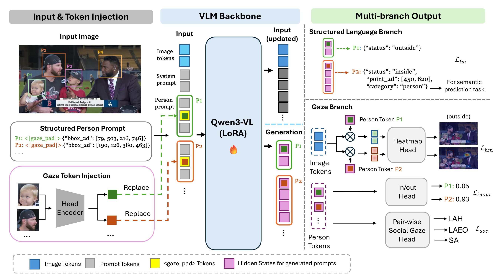

# OmniGF

This is the official code implementation for **OmniGF: A Dual-Branch Vision-Language Framework for Unified Gaze Following** accepted to NeurIPS 2026 as a Spotlight
([paper](https://arxiv.org/abs/2605.26399)).

OmniGF builds on Qwen3-VL-4B-Instruct, adapted with LoRA (rank 16 on `q_proj` /
`v_proj`). Each person in the image gets a prompt line with their head box and a gaze
token computed from the head crop by a ResNet-18 encoder (initialised from Gaze360). For
all persons at once, the model then predicts:

- **structured language branch:** a JSON line per person with in/out status, the gaze
  point and, for semantic gaze, the category of the gaze target;
- **gaze branch:** from each person's hidden state, a 64x64 gaze heatmap and an in/out
  score, and for social gaze, LAH / LAEO / shared-attention scores for every pair of
  persons.

<p align="center">
  
</p>

## Release status

- [x] Training and evaluation code
- [x] Pretrained weights ([Checkpoints](#checkpoints))
- [ ] Extra annotation files: extended GazeFollow, refined GazeFollow semantic labels,
      GazeHOI annotations, CLIP vocabularies (see [Data](#data))
- [ ] Inference demo on arbitrary images

## Installation

```bash
conda create -n omnigf python=3.11 -y
conda activate omnigf
pip install torch==2.8.0 torchvision==0.23.0 --index-url https://download.pytorch.org/whl/cu128
pip install -r requirements.txt
```

Keep `transformers==5.2.0`. Version 5.3 changed Qwen3-VL's rotary position layout, and
the released LoRA weights score materially worse under it.

Qwen3-VL-4B-Instruct and CLIP (`openai/clip-vit-base-patch16`, used to map predicted
categories onto a test vocabulary) are downloaded from the Hugging Face Hub on first use,
and NLTK WordNet on the first semantic evaluation. Training used up to about 70 GB of GPU
memory (one 96 GB GPU); evaluation needs about 20-30 GB.

## Data

All launchers read paths from [`scripts/paths.sh`](scripts/paths.sh). By default
everything lives under `./data` (`DATA_ROOT`), and every path can be overridden from the
environment.

```
data/
  VSGaze/                         annotation H5s from the VSGaze release
    gazefollow_{train,val,test}.h5
    vat_{train,val,test}.h5
    childplay_{train,val,test}.h5
    videocoatt_{train,val,test}.h5
    uco_laeo_{train,val,test}.h5
    gazefollow_train_extended.h5  (*) GazeFollow train with out-of-frame persons added
    semgaze_merge/                (*) GazeFollow with semantic target labels
      gazefollow_train_with_semgaze_corrected.h5
      gazefollow_val_with_semgaze_corrected.h5
      gazefollow_test_with_semgaze.h5
  vocab/                          (*) CLIP label embeddings
    gazefollow/  train_vocab_embeddings.pt  train_label2id.json
                 test_vocab_embeddings.pt   test_vocab_labels.json
    gazehoi/     the same files, plus vocab2id.json
  GazeHOI/                        images, plus
    h5_annotations/               (*) gazehoi_{train,val,test}.h5
  gazefollow/  videoattentiontarget/  ChildPlay/  VideoCoAtt_Dataset/  ucolaeodb/
```

- **Annotations:** from the [VSGaze dataset page](https://doi.org/10.34777/jggs-1128)
  (Idiap).
- **Images:** from each dataset's own release:
  [GazeFollow](https://www.dropbox.com/s/3ejt9pm57ht2ed4/gazefollow_extended.zip?dl=0),
  [VideoAttentionTarget](https://www.dropbox.com/s/8ep3y1hd74wdjy5/videoattentiontarget.zip?dl=0),
  [ChildPlay](https://www.idiap.ch/en/scientific-research/data/childplay-gaze),
  [VideoCoAtt](https://github.com/LifengFan/Shared-Attention) (we used the frames the
  dataset provides), [UCO-LAEO](https://github.com/AVAuco/ucolaeodb).
- **(\*) Files we will release:** the extended GazeFollow train file, the GazeFollow
  semantic labels (SemGaze labels, refined), the GazeHOI annotations and the CLIP
  vocabularies. GazeHOI images are assembled from its source HOI datasets.
- **Head-encoder init:** training starts the head encoder from Idiap's
  [ResNet-18 Gaze360 model](https://doi.org/10.34777/bz8n-ps75); put it at
  `./checkpoints/gaze360_resnet18.pt` (`CKPT_ROOT`):
  `hf download Idiap/resnet18-gaze360 gaze360_resnet18.pt --local-dir checkpoints`.

## Checkpoints

The weights are on the Hugging Face Hub at
[StonyBrook-CVLab/omnigf](https://huggingface.co/StonyBrook-CVLab/omnigf). Put them under
`./checkpoints` (`CKPT_ROOT`), where the launchers look for these names:

```bash
hf download StonyBrook-CVLab/omnigf --include "*.safetensors" --local-dir checkpoints
```

| Task | Dataset | Checkpoint |
|---|---|---|
| Gaze target estimation | GazeFollow | [omnigf_gazefollow.safetensors](https://huggingface.co/StonyBrook-CVLab/omnigf/resolve/main/omnigf_gazefollow.safetensors) |
| Gaze target estimation | GazeFollow, with in/out loss (warm start for VideoAttentionTarget, ChildPlay and VSGaze) | [omnigf_gazefollow_inout.safetensors](https://huggingface.co/StonyBrook-CVLab/omnigf/resolve/main/omnigf_gazefollow_inout.safetensors) |
| Gaze target estimation | VideoAttentionTarget | [omnigf_vat.safetensors](https://huggingface.co/StonyBrook-CVLab/omnigf/resolve/main/omnigf_vat.safetensors) |
| Gaze target estimation | ChildPlay | [omnigf_childplay.safetensors](https://huggingface.co/StonyBrook-CVLab/omnigf/resolve/main/omnigf_childplay.safetensors) |
| Semantic gaze prediction | GazeFollow | [omnigf_semantic_gazefollow.safetensors](https://huggingface.co/StonyBrook-CVLab/omnigf/resolve/main/omnigf_semantic_gazefollow.safetensors) |
| Social gaze prediction | VSGaze | [omnigf_social_vsgaze.safetensors](https://huggingface.co/StonyBrook-CVLab/omnigf/resolve/main/omnigf_social_vsgaze.safetensors) |

Each file holds only the weights OmniGF trains (LoRA, head encoder, heads; about 115 MB).
The Qwen3-VL-4B-Instruct backbone is downloaded from the Hugging Face Hub. `CKPT=` and
`PRETRAINED_CKPT=` also accept the Lightning `.ckpt` files your own training writes, and
`scripts/export_release_weights.py` converts one into this format.

## Usage

Every recipe runs on one GPU (pick it with `CUDA_VISIBLE_DEVICES`) with batch size 8 and
2 gradient-accumulation steps. Evaluation launchers take the checkpoint from `CKPT=...`,
and fine-tuning launchers take their warm start from `PRETRAINED_CKPT=...`; both default
to the checkpoint names in `./checkpoints`. `SEED=` changes the seed, and extra Hydra
overrides can be appended to any command. Metrics are printed at the end of each run and
saved in the Hydra run directory under `experiments/`. Runs that end with a test evaluate
the checkpoint with the best validation score.

### Gaze target estimation

Tables 1 and 2 of the paper. Distances are L2 in normalised image coordinates; AP is
in/out-of-frame average precision.

| Method | GazeFollow Avg Dist. ↓ | GazeFollow Min Dist. ↓ | VAT Dist. ↓ | VAT AP ↑ | ChildPlay Dist. ↓ | ChildPlay AP ↑ |
|---|---|---|---|---|---|---|
| Sharingan | 0.113 | 0.057 | 0.107 | 0.891 | 0.106 | 0.990 |
| Gaze-LLE (ViT-L) | 0.099 | 0.041 | 0.103 | 0.903 | 0.101 | 0.994 |
| **OmniGF** | **0.091** | **0.040** | **0.096** | **0.923** | **0.090** | **0.996** |

**Training.** GazeFollow is trained from the base model; VideoAttentionTarget and
ChildPlay are fine-tuned from the GazeFollow model trained with the in/out loss.

```bash
bash scripts/train_gazefollow.sh                  # GazeFollow, 20 epochs
VARIANT=inout bash scripts/train_gazefollow.sh    # with the in/out loss (warm start below)
DATASET=vat       bash scripts/finetune_video.sh  # 3 epochs, about 1 h
DATASET=childplay bash scripts/finetune_video.sh  # 3 epochs, about 1.5 h
```

**Evaluation.**

```bash
bash scripts/test_gazefollow.sh
DATASET=vat       bash scripts/test_video.sh
DATASET=childplay bash scripts/test_video.sh
bash scripts/eval_zeroshot_gazefollow.sh          # zero-shot Qwen3-VL-4B baseline (Table 3)
```

### Semantic gaze prediction

Table 4 of the paper, on GazeFollow. SemGaze\* is SemGaze retrained on our refined
labels.

| Method | Avg Dist. ↓ | Min Dist. ↓ | Acc@1 ↑ | MultiAcc@1 ↑ |
|---|---|---|---|---|
| SemGaze | 0.108 | 0.051 | 0.447 | 0.516 |
| SemGaze\* | 0.109 | 0.053 | 0.527 | 0.598 |
| **OmniGF** | **0.092** | **0.040** | **0.649** | **0.739** |

**Training.** Both models are fine-tuned from the GazeFollow model above
(`train_gazefollow.sh`).

```bash
bash scripts/finetune_semantic_gazefollow.sh      # GazeFollow, 8 epochs, about 2 h each
bash scripts/finetune_semantic_gazehoi.sh         # GazeHOI (Table 5)
```

**Evaluation.**

```bash
bash scripts/test_semantic_gazefollow.sh
CKPT=/path/to/your.ckpt bash scripts/test_semantic_gazehoi.sh   # Table 5, a model from finetune_semantic_gazehoi.sh
```

### Social gaze prediction

Table 6 of the paper, on VSGaze (VideoAttentionTarget, ChildPlay, VideoCoAtt and
UCO-LAEO). MTGS is the only other method that predicts social gaze end to end.

| Method | Dist. ↓ | AP_IO ↑ | F1_LAH ↑ | F1_LAEO ↑ | AP_SA ↑ |
|---|---|---|---|---|---|
| MTGS | 0.107 | 0.940 | 0.795 | 0.590 | 0.576 |
| **OmniGF** | **0.098** | **0.992** | **0.814** | **0.742** | **0.787** |
| OmniGF (released checkpoint) | 0.099 | 0.992 | 0.816 | 0.756 | 0.758 |

**Training.** Fine-tuned from the GazeFollow model trained with the in/out loss
(`VARIANT=inout bash scripts/train_gazefollow.sh`).

```bash
bash scripts/finetune_social_vsgaze.sh            # 10 epochs, about 25 h
```

**Evaluation.**

```bash
bash scripts/test_social_vsgaze.sh
```

## Repository layout

```
omnigf/vlm/models_ge.py           OmniGF Lightning module (LoRA, gaze-token injection, heads)
omnigf/vlm/dataset.py             prompt and target construction
omnigf/vlm/collator.py            tokenisation, label masking, token positions
omnigf/vlm/{heads,decoders,losses,parser,evaluation}.py
omnigf/vlm/text_to_id_mapper.py   category -> test vocabulary (CLIP + WordNet)
omnigf/datasets/                  per-dataset loaders and the unified frame-level index
omnigf/performance/               gaze and social-gaze metrics
omnigf/config/                    Hydra configs (vlm_config.yaml: GazeFollow and GazeHOI;
                                  vlm_vsgaze_config.yaml: video datasets and VSGaze)
scripts/                          entry points (main_vlm.py, main_vlm_vsgaze.py) and launchers
scripts/export_release_weights.py Lightning .ckpt -> release .safetensors (trained weights only)
assets/                           framework figure (PDF, and the PNG shown above)
```

## License

The code is released under GPL-3.0-only (see `LICENSES/`), as it derives from MTGS.
The head encoder is initialised from Idiap's ResNet-18 Gaze360 model, which is licensed
CC BY-NC 4.0, so the released OmniGF weights are for non-commercial use only.
Qwen3-VL-4B-Instruct is licensed Apache-2.0.

## Citation

```bibtex
@inproceedings{miao2026omnigf,
  title     = {OmniGF: A Dual-Branch Vision-Language Framework for Unified Gaze Following},
  author    = {Miao, Qiaomu and Wu, Haoyu and Xu, Jingyi and Hoai, Minh and Samaras, Dimitris},
  booktitle = {Advances in Neural Information Processing Systems (NeurIPS)},
  year      = {2026}
}
```

## Acknowledgements

Our code is based on [MTGS](https://github.com/idiap/MTGS)
([Gupta et al., NeurIPS 2024](https://proceedings.neurips.cc/paper_files/paper/2024/hash/1caf09c9f4e6b0150b06a07e77f2710c-Abstract-Conference.html)),
whose data loaders, head encoder and evaluation metrics OmniGF reuses. We thank the
authors for releasing their code.
